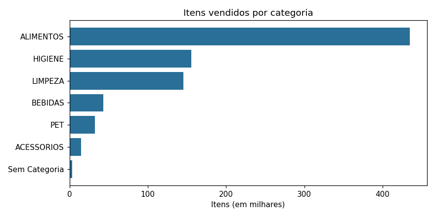
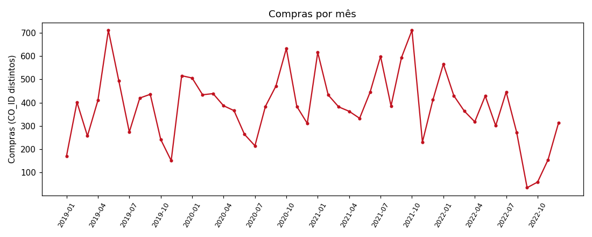
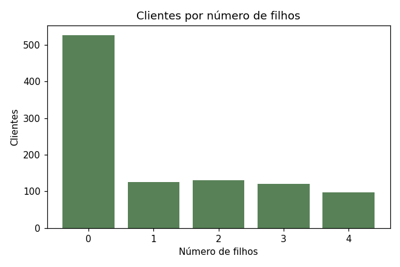

Miniprojeto: Análise Exploratória do Varejo

Análise de Dados com Python [T9] · Módulo 1 · Semana 07
Aluno: João Primo · Turma: Analise_de_Dados_T9

Análise Exploratória de Dados (AED) da base Varejo ([Kaggle: namespaiva/base-varejo](https://www.kaggle.com/datasets/namespaiva/base-varejo/data)), feita em Python com pandas: importação, diagnóstico de qualidade, limpeza, estatística descritiva, agrupamentos e conclusões.

> Para rodar o projeto, veja [`README_JoaoPrimo_Analise_de_Dados_T9.md`](README_JoaoPrimo_Analise_de_Dados_T9.md).

 1. A base

830.000 linhas, 4 anos de compras (04/01/2019 a 08/12/2022), 18.471 compras, 1.000 clientes, 229 produtos, 6 categorias (+ "Sem Categoria" após a limpeza).

| Coluna | Significado |
|---|---|
| `DATA` | data da compra (dd/mm/aaaa) |
| `CO_ID` | identificador da compra (uma compra tem vários itens) |
| `CL_ID` | identificador do cliente |
| `CL_GENERO` | gênero do cliente (M/F) |
| `CL_EC` | estado civil, código de 1 a 5 (a base não traz a legenda) |
| `CL_FHL` | número de filhos do cliente |
| `CL_SEG` | segmento do cliente (A, B, C) |
| `PR_ID`, `PR_CAT`, `PR_NOME` | identificador, categoria e nome do produto |

Atenção: a base não tem preço nem quantidade. Por isso, neste projeto, *vendas* = volume de itens e *compras* = número de `CO_ID` distintos.

2. O que o script faz (um bloco por Sprint)

| Sprint | O que foi feito |
|---|---|
| 1. Importação | Leitura com `csv.DictReader` (módulo nativo) → `DataFrame`. Mostra registros, colunas e tipos. Aceita o `.csv` ou o `.zip` do Kaggle. |
| 2. Funções de limpeza | `limpar_texto`, `limpar_inteiro`, `limpar_decimal` e `converter_data` (`datetime.strptime`), com expressões regulares. |
| 3. Diagnóstico e limpeza | Relatório de nulos, duplicatas e inconsistências na base bruta; depois limpeza em 3 etapas (nulos, duplicatas, tipos). |
| 4. Estatística | Média, mediana, desvio padrão, moda, mínimo, máximo, contagem e quartis do número de filhos. |
| 5. Relatório | Agrupamentos (`groupby` e `pivot_table`), 3 gráficos, contadores finais e conclusões, tudo impresso no terminal. |
| 6. Versionamento | Grava `saida/df_limpo.csv` e `saida/relatorio_terminal.txt`. |

3. Problemas encontrados e decisões de limpeza

| Problema (base bruta) | Quantidade | Decisão | Por quê |
|---|---|---|---|
| 4 colunas sem nome, 100% vazias (`;;;;` no fim de cada linha) | 4 colunas | Descartadas | Não carregam informação. |
| `#N/D` (erro de PROCV do Excel) em `PR_CAT` e `PR_NOME` | 3.650 linhas (0,44%), todas do `PR_ID` 107 | `PR_CAT` → **"Sem Categoria"** e `PR_NOME` → "Sem Nome" (lógica `if/else`) | O item foi vendido de verdade: apagar distorceria o volume. Imputar a moda seria inventar informação. |
| Texto fora do padrão (`REFRIGERANTE LIMaO`) | 7.320 linhas | Padronizado por regex (maiúsculas, sem acento, sem espaços extras) | Evita o mesmo produto aparecer duas vezes. |
| Linhas 100% duplicadas | 96.553 (11,63%), em 14.566 compras | Eliminadas, **mas contadas na nova coluna `QTD`** | Sem coluna de quantidade, a repetição dentro da mesma compra é tratada como mais de uma unidade (hipótese). Nada se perde: a soma de `QTD` continua 830.000. |
| `DATA` como texto | 830.000 | Convertida para `datetime` | Texto ordena por dia, não por data; sem `datetime` não há série temporal. |
| IDs, estado civil e filhos como texto | | Convertidos para inteiro; texto repetido vira `category` | Permite contas e economiza memória. |

Se aparecessem nulos em `DATA`, `CO_ID`, `CL_ID` ou `PR_ID`, a linha seria removida (sem a chave não dá para analisar). Nulos em atributos do cliente seriam imputados com o valor do mesmo `CL_ID` em outras linhas. Esses caminhos foram testados com dados sujos injetados, mas a base real não os aciona.

> Esta base não possui colunas de dimensões físicas (peso, altura etc.). Os únicos nulos reais estão em `PR_CAT` e `PR_NOME`, tratados acima.

Regra de negócio do identificador de compra (`CO_ID`) validada: das 18.471 compras, 0 estão ligadas a mais de um cliente ou a mais de uma data. Também há 0 clientes com atributos conflitantes e 0 `PR_ID` com mais de um nome ou categoria.

Resultado: `saida/df_limpo.csv` com **733.447 linhas × 11 colunas**, 0 nulos.

4. Estatística descritiva: número de filhos (`CL_FHL`)

O número de filhos é atributo do cliente; por isso a visão principal usa 1 linha por cliente (usar as linhas da base faria quem compra mais pesar mais).

| Estatística | Por cliente (principal) | Por compra (comparação) |
|---|---:|---:|
| Contagem | 1.000 | 18.471 |
| Média | 1,136 | 1,143 |
| Mediana | 0 | 0 |
| Desvio padrão | 1,413 | 1,418 |
| Moda | 0 | 0 |
| Mínimo | 0 | 0 |
| Q1 (25%) | 0 | 0 |
| Q2 (50%) | 0 | 0 |
| Q3 (75%) | 2 | 2 |
| Máximo | 4 | 4 |

Distribuição dos clientes: 0 filhos = 527 (52,7%), 1 = 125 (12,5%), 2 = 130 (13,0%), 3 = 121 (12,1%), 4 = 97 (9,7%).

5. Insights

1. Alimentos dominam. `ALIMENTOS` é 52,4% dos itens e aparece em 98,9% das compras; higiene (18,7%) e limpeza (17,6%) vêm a seguir. "Sem Categoria" é 0,44% dos itens.
2. Gênero: mais clientes F, não compra diferente. Clientes F respondem por 52,1% dos itens (519 dos 1.000 clientes). O tamanho médio da compra é praticamente igual (44,9 × 45,0 itens) e o mix de categorias difere no máximo 0,16 ponto percentual.
3. Tempo. 2021 foi o ano de maior volume (245.259 itens) e 10/2021 o mês de pico (32.327 itens). Em 09/2022 e 10/2022 houve só 35 e 59 compras (mediana mensal: 386): indício de falha de coleta, não de queda real. 12/2022 é parcial (dados até 08/12).
4. Filhos. Média 1,14, mediana 0, moda 0: 52,7% dos clientes não têm filhos e a média maior que a mediana mostra distribuição assimétrica à direita.
5. Filhos não explicam a compra. 52,7% dos itens infantis (fralda, chupeta, mordedor, papinha) são comprados por clientes **sem** filhos, exatamente a fração de clientes sem filhos. Itens por compra variam só de 44,5 a 45,7 entre grupos e os 10% maiores clientes respondem por 15,1% dos itens. Essa uniformidade sugere base sintética ou sorteada (hipótese, não prova).
6. Problemas remanescentes. Sem preço/quantidade, "vendas" é só volume e `QTD` depende da hipótese das duplicatas; 228 `PR_ID` para 117 nomes (ex.: PRESUNTO COZIDO tem 4 IDs), então ranking por nome mistura SKUs; `CL_EC` sem legenda; `PR_ID` 107 sem categoria/nome; meses 09 e 10/2022 com volume anormalmente baixo.

6. Reflexão teórica: ETL e qualidade de dados

**ETL** é o caminho que leva o dado do estado bruto ao estado utilizável: *Extract* (extrair), *Transform* (transformar) e *Load* (carregar). Neste projeto:

- **Extract:** o `csv.DictReader` lê o arquivo como veio, tudo texto, inclusive as 4 colunas fantasmas e o `#N/D`. Ler sem corrigir é proposital: o diagnóstico precisa enxergar o problema real.
- **Transform:** padronização de texto, tratamento de nulos, eliminação de duplicatas, conversão de tipos e colunas derivadas (`ANO`, `MES`, `ANO_MES`).
- Load: gravação do `df_limpo.csv`, pronto para alimentar um dashboard ou análises mais avançadas.

A ordem importa. Com a data ainda como texto, `"01/02/2019"` ordena pelo dia antes do ano, e o gráfico mensal sairia errado. Sem tratar o `#N/D`, ele apareceria como se fosse uma categoria e um produto.

Qualidade de dados não é uma nota única; são dimensões, e cada uma apareceu nesta base:

| Dimensão | O que a base mostrou |
|---|---|
| Completude | 3.650 linhas sem categoria/nome; 4 colunas 100% vazias |
| Unicidade | 96.553 linhas repetidas (11,63%) |
| Validade | `LIMaO` fora do padrão (7.320 linhas); datas, gênero e segmento válidos |
| Consistência | cada `CO_ID` tem 1 cliente e 1 data; mas 228 `PR_ID` para 117 nomes |
| Cobertura no tempo | 09 e 10/2022 quase sem compras |

Três lições: (1) **limpar não é apagar**: nenhuma venda foi descartada (830.000 itens antes e depois) e cada decisão foi registrada e justificada; (2) **diagnosticar vem antes de limpar**, senão não se sabe o que foi corrigido; (3) **dado limpo ainda tem limites**: sem preço, sem legenda de `CL_EC` e com padrões artificialmente uniformes, as conclusões de negócio precisam ser dadas com cautela. Dizer isso também faz parte da qualidade.

 7. Estrutura do repositório

Miniprojeto_JoaoPrimo_Analise_de_Dados_T9/
├── analise_varejo.py                          # script completo (Sprints 1 a 6)
├── README.md                                  # este arquivo
├── README_JoaoPrimo_Analise_de_Dados_T9.md    # instruções simples de execução
├── requirements.txt
├── .gitignore
├── dados/
│   ├── Base_Varejo.zip                        # base original do Kaggle (3,9 MB)
│   └── LEIA-ME.md
└── saida/
    ├── df_limpo.csv                           # base limpa (733.447 x 11)
    ├── relatorio_terminal.txt                 # relatório completo gerado pelo script
    └── grafico_*.png                          # 3 gráficos

